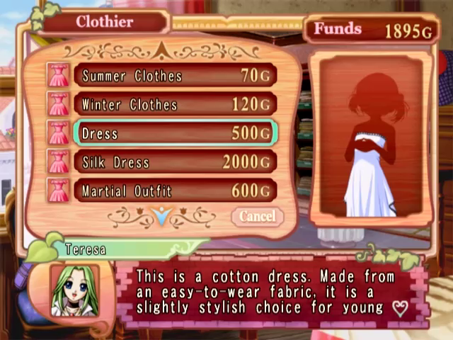
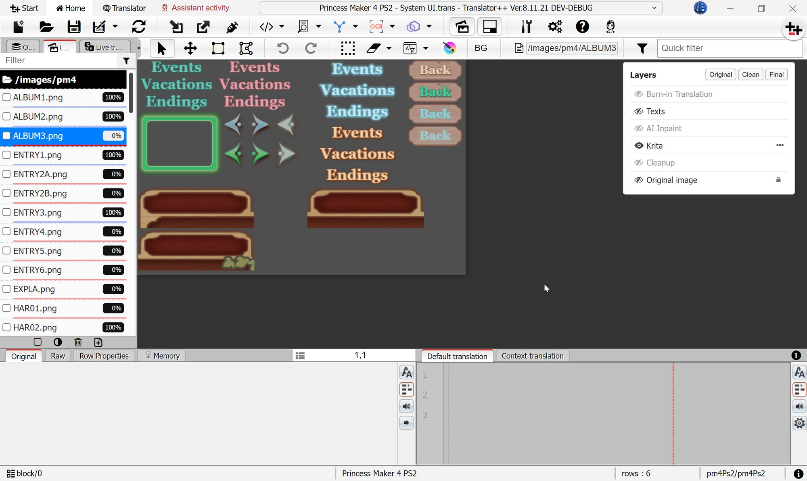
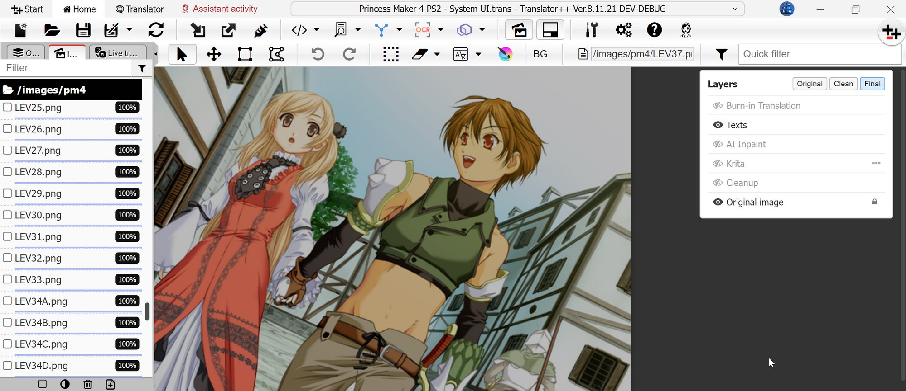
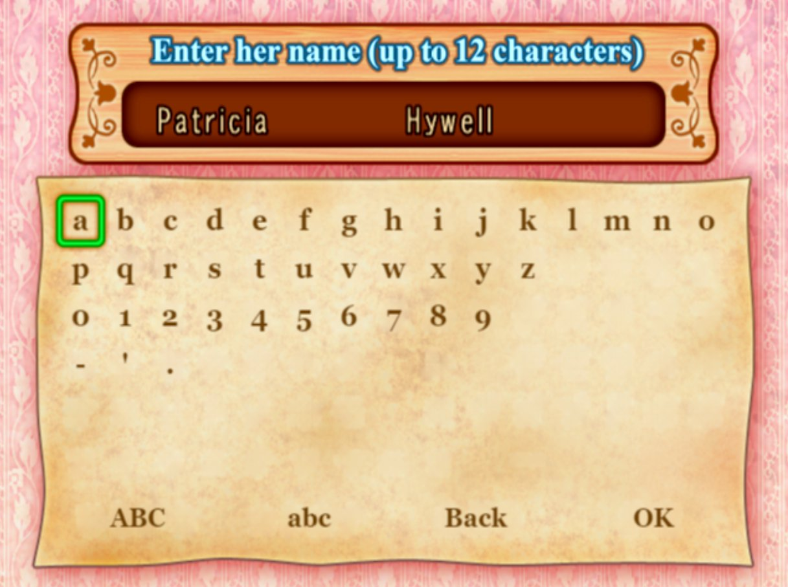

# Princess Maker 4 usage guide

See the [README](README.md) for showcase screenshots, installation, and a quick start.

## PlayStation 2 workflow (`SLPM_659.36`)

Open a Japanese **SLPM_659.36** PS2 ISO in Translator++, translate its text and artwork, and export a separate disc image. The original ISO is read-only.

1. Choose **New Project → Princess Maker 4 (PS2 / PC)** and select the `.iso`.
2. Edit `ROOM.G2` (story and choices), `PRIME4.G2` (startup/system messages), the item lists, and `SLPM_659.36` (memory-card, save and load prompts, return to title, and birthdays). The original language is Japanese. The initial target is English and can be changed in Translator++.
3. Save the `.trans` project normally. Keep the original ISO at its selected location: it is required for export and project updates.
4. Use **Export → Folder** to create `<original>.translated.iso` in the output folder. ZIP export wraps that ISO in a ZIP. **Inject** also creates a separate ISO in the destination folder; it does not overwrite the source disc. Existing exports get numbered filenames.

Only checked/selected resources and the normal Translator++ row/tag filters are translated during text export. Image export follows the selected image files and their visible layers. Every other disc byte is copied from the original. The normal rightmost nonempty translation and context overrides are supported.

Use **Update Project from Source** to add `SLPM_659.36` to an existing project. These rows must fit the CP932 byte limit and original line count shown in the row notes. The shared birthday format must keep three decimal placeholders in year, month, day order. For example, `%d-%02d-%02d` produces `1430-04-13`.

New projects include an **Actor Reference** with editable name translations, pronouns, and short speech notes. AI translation can use the reference to identify speakers, including **Daughter**. Find the game's tone and storage guidance under **Translator → Prompts**.

## PC release (2005 Japanese Windows)

1. Choose **New Project → Princess Maker 4 (PS2 / PC)** and select `PM4.exe` in the folder of the Japanese PC release (or the folder itself). The project imports `room.g2`, `prime4.g2`, `item_nam.txt` and `item_msg.txt` from the folder's `script` archive. The game folder is not changed.
2. Translate as for the PS2 disc. The script format, limits, pages and `{{daughter}}` placeholders are the same.
3. **Inject** into the game folder rebuilds `script` with the translation. The first time, it copies the Japanese original to `script.orig_backup` (the same name the community English patch uses). Later exports read the original from that backup. To undo, copy `script.orig_backup` over `script`. **Export → Folder** writes only a `script` file to copy into the game folder yourself.

Close the game before Inject. Export refuses to replace a `script` in a game folder that is not the Japanese original unless a `script.orig_backup` is there. If the folder already holds an English-patched `script` with its backup, the project uses the backup.

Differences from the PS2 disc:

- The rebuilt archive stores the changed entries uncompressed, so `script` grows from about 1.3 MB to 2.5 MB or more, as with the community English patch, which the game accepts. Other entries are copied unchanged.
- The PC scripts store line breaks as line feed bytes, not `\n` text; the writer keeps that. Item lists use `\n` text on both versions.
- The PC text windows are pixel rectangles (the dialogue box is 440 × 70), not the PS2's character pools, so no window patch is needed or applied.
- System messages in the executable, artwork, and the English keyboard are PS2 only. The PC executable is copy-protected and is never changed.
- The stock PC game draws text with a Western character set: on a non-Japanese Windows locale, two-byte characters (Japanese, and full-width punctuation in English) lose their first byte. ASCII English is unaffected. Run the game with a Japanese locale or a font fix if you keep two-byte characters.
- The PC game shows `㍍` as a heart and `㌍` as "!?" (pictures in its `data` archive). Keep them, or replace them with ASCII punctuation.

The PC path has been checked against the retail `script` archive: extraction, a rebuild with translated and paged dialogue, and re-reading the result with an independent decoder. It has not yet been played in the PC game.

## Text constraints and multi-page messages

- **Translations can be longer than the Japanese.** The writer relocates the script bytecode and fixes every offset in it: function entries, labels, jumps, calls and choice-menu handlers. It then checks that the rebuilt script is the same program as the original. Item lists are simply rebuilt.
- Select a row to see its **CP932 limit** and the Japanese length in the grid toolbar. ASCII normally costs one byte, Japanese two. The limits are set by the game engine, not by the Japanese text:

  | Text | Limit |
  | --- | --- |
  | Dialogue, up to 3 Japanese lines (about three pages of English) | 360 bytes |
  | Item descriptions | 180 bytes |
  | Longer messages (letters, endings) | twice the Japanese, up to 960 bytes |
  | Choices, speaker names and other short strings | 24 bytes, or 1.5× the Japanese when longer |
  | Item names | 18 bytes |

  A row whose Japanese is already longer keeps the Japanese length as its limit. These limits are guides: going over one is a warning in the Inject log. Export stops, listing grid row numbers and byte counts, only for characters Shift-JIS cannot store, changed `%` codes or `{{…}}` placeholders, and a page over 960 bytes (the game's message buffer). Text is never truncated.
- **Long dialogue continues on new pages.** A dialogue box shows 3 lines. When a translation has more lines than that (or than its Japanese, for longer messages), export splits it after every third line. The player presses a button and the rest appears in a fresh box, with the same speaker. Blank lines at the top of a new page are dropped. Narration that the Japanese builds up over several button presses without clearing the box is not split. The Inject log says how many messages were split.
- **Break lines yourself.** The game never wraps a line: a line that is too wide runs past the right edge of the box. Each `\n` is one line on screen. In the editor, a different line count, moved blank lines and lines wider than about **34 half-width characters** are warnings only. The grid shows real line breaks; the writer restores the game's literal `\n` escapes.
- Keep `%d`, `%2d`, `%3d`, and other placeholders in their original order.
- Whenever text changes on PS2, export also raises the text windows' character capacity in both game scripts. Japanese capacities crop English: the dialogue window stopped after about 80 characters in PCSX2. It goes from 50 to 120 characters, and the six small windows (choices and labels) go from 9 to 16. Exporting translated item names also enlarges the shop and inventory item-list buffer in `SLPM_659.36`, preventing cropping on the fifth visible row. This uses a few hundred KB more console RAM.



- A PS2 script that outgrows its disc sectors takes over the space of the developer-only `TEST.G2`, and then `DEVTEST.G2`. Their directory entries are set to empty, so only the developer menu loses them. If a project includes those scripts and translates them, their space is not reused. The ISO size never changes.
- **Saves.** A save records a position inside the script. Saves from the original disc or from an export with different text may not resume correctly, so test on fresh saves.
- Characters outside CP932, including emoji, accented letters and most non-Japanese Asian scripts, are refused, and the error names each one. Punctuation that Shift-JIS has under a different Unicode code point is converted automatically: the em dash `—` becomes `―`, and likewise `〜`, `‖`, `−`, `¢`, `£` and `¬`. CP932 representability does not establish that a glyph exists in the game's font.

### Player names inside dialogue

Translate the whole row around `{{daughter}}` or `{{father}}`. The game fills in the player's chosen name. Other direct string variables use their slot number, such as `{{str17}}`. Keep the placeholders exactly once per original occurrence, in their original order. You can move the words and line breaks around them. Export and Inject rebuild the script with its original variable commands.

For an existing project, use **Update Project from Source** after restarting Translator++. Existing translation columns for split fragments are combined around the placeholders. Review the resulting sentences for grammar.

## Game artwork and PNG editing (PS2)

By default, new projects include **80 editable interface sheets**. Turn on **Include all game artwork (including CGs)** to load all **1,263 sprite sheets** from the Japanese PS2 disc, including event and ending CGs, backgrounds, character art, portraits, and thumbnails. The OCR option applies to interface sheets. Game movies and fonts are outside this workflow.



In an existing project, choose **Tools → Princess Maker 4 (PS2) → Add all game artwork (without OCR)**. This adds missing sheets to the **Images** pane, including sheets without text, and keeps existing image edits and OCR boxes. **Add game images to this project** imports missing interface sheets with OCR. Use Image edit mode to draw or translate text boxes, or choose **Edit current image in Krita** to paint the whole sheet. Untranslated boxes preserve the source pixels.



For another image editor:

1. Choose **Tools → Princess Maker 4 (PS2) → Export PNGs for editing** and an empty folder. This exports the current compositions, with unchanged sheets copied losslessly.
2. Edit the PNGs, preserving their **filenames, dimensions and transparency**. Save as **non-interlaced 8-bit RGB/RGBA PNG**. Only include the sheets you changed in the re-import folder.
3. Choose **Import edited PNGs** and that folder. The imported full sheets are stored as replacement layers; the original layer is hidden to avoid doubled alpha. The original PNG remains intact. Existing painted layers get backups.
4. Save the `.trans` project. **Inject**, folder export and ZIP export repack the edited sheets into their original SPD/TIM2 resources **inside the ISO**. Resize, unsupported PNG or sprite format errors stop export rather than relocating resources or writing loose PNGs beside the disc image.

Project update preserves image text, drawn boxes, styles and staged paint layers when the original sheet is unchanged. Save the previous project before updating if replacing the source disc with a different revision.

Full PNG sheets—not independent cropped labels—are the editable unit, so sprite coordinates keep their original meaning. Schedule sheets contain every animation frame; edit repeated lettering in all frames.

## English name-entry keyboard (PS2)

In **Inject**, enable the **English name-entry keyboard** flipswitch to replace the two kana pages with **ABC / abc**, digits and punctuation. It is off by default. The patch changes both the pictures and the native input tables in the exported ISO, so the keys enter the characters shown on screen.

**Allow 12 half-width characters per name field** enables the English keyboard and supports up to 12 ASCII characters in both the surname and given name—enough for **Patricia Hywell**. The standard English keyboard supports six full-width characters per field. Use the on-screen controller keyboard to enter names.



The switch applies to the whole output disc even when only some project files are selected. It replaces lettering in the key and bottom-button areas of `ENTRY2A.SPD` and `ENTRY2B.SPD`, including edits in those areas. The 12-character option also replaces the two name prompts in `ENTRY5.SPD`. Other image edits are retained. Turn it off to keep your own name-entry artwork and original kana input. Each Inject starts with the switch off, and the original ISO is unchanged.

English name entry and subsequent display in the status panel, save slots, and dialogue speaker plate have been verified in PCSX2.

## Scope and limits

Default import has **10,657 distinct editable rows** across four resources on the inspected retail disc. Repeated text shares a row, with all occurrences and their byte limits retained. Verified speaker names appear in the expanded row headers. The parser tracks explicit name-plate commands across statements and voice calls, so tutorial dialogue such as the Cube status explanation is labelled `キューブ`. Repeated dialogue retains speaker information for each occurrence.

Speaker coverage is partial. Known runtime variables display **Daughter (custom name)** and **Father (custom name)**, since the actual names depend on the player's save. Unknown variables, conflicting branch paths, and names after unverified native/script calls remain blank. `speakerKind` in row parameters distinguishes literal, runtime, cleared, and unknown names. This is conservative metadata extraction, not a complete execution of the game's VM.

Resource paths and non-Japanese short engine strings are excluded. Bytecode symbols and album manifests are not translation targets.

The optional **Include TEST.G2 and DEVTEST.G2** setting imports development scripts too. It is off by default to avoid translating near-duplicate content, and so that their disc space stays available for longer translations.

This supports script text, picture-based lettering, and the optional name-entry keyboard table patch. Font replacement is not supported. The community PC English patch's fixed patch offsets, UI images and executable patches do not apply to the PS2 disc, and this add-on does not use them on PC either: it rebuilds the PC scripts the same way as the PS2 ones. No translation data or game assets are bundled here.

## Development

`pm4Ps2.module.js` provides portable extraction, strict VM validation, relocating G2 rewriting with a same-program check, ISO discovery and extent planning, staging, streamed ISO export, and the PC game-folder export. `pm4Ps2.gcex.js` reads and rebuilds the PC release's GCEX archives. `pm4Ps2.js` supplies the project wizard, detector, AddonUtils hooks, and folder/ZIP/inject integration. `pm4Ps2.images.js` decodes/rebuilds SPD/TIM2 sheets and lossless PNGs; `pm4Ps2.keyboard.js` validates and replaces native keyboard tables and key labels; `pm4Ps2.image-ui.js` integrates the Images pane, OCR, paint-layer re-import and whole-disc image injection. Saved creation settings and the original ISO checksum live in `project.options.init`; text resources and decoded image sheets are staged.

Run from the Translator++ repository root:

```powershell
& '3rdParty/node-v24.17.0-win-x64/node.exe' --test www/addons/pm4Ps2/test/pm4Ps2.module.test.js www/addons/pm4Ps2/test/pm4Ps2.images.test.js www/addons/pm4Ps2/test/pm4Ps2.keyboard.test.js www/addons/pm4Ps2/test/pm4Ps2.pc.test.js
```

Tests generate original synthetic G2/ISO/GCEX fixtures; no retail game content is included. The optional worker is a source-development helper and is excluded from compiled packages. The app integration uses the module directly.

See [format notes](plan/README.md) for measured PS2 details.
